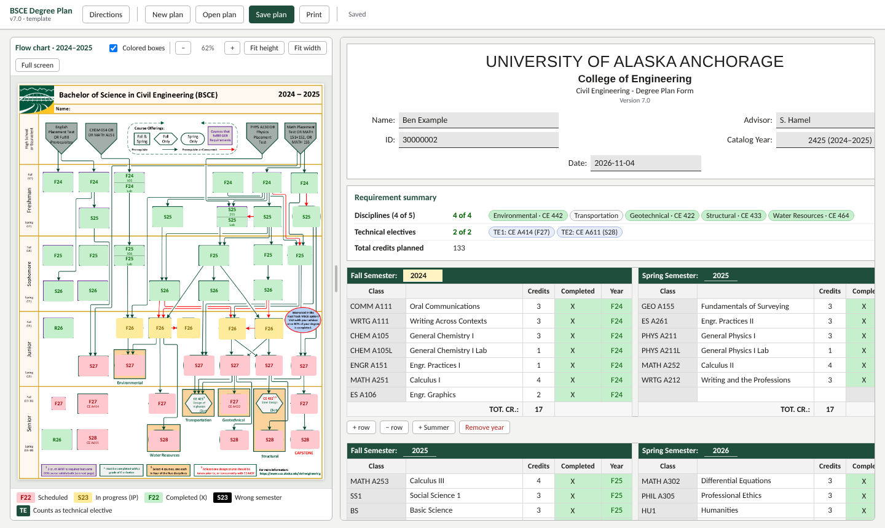
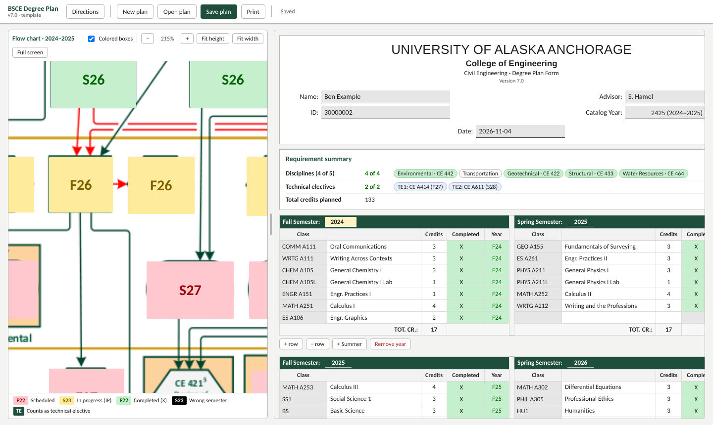
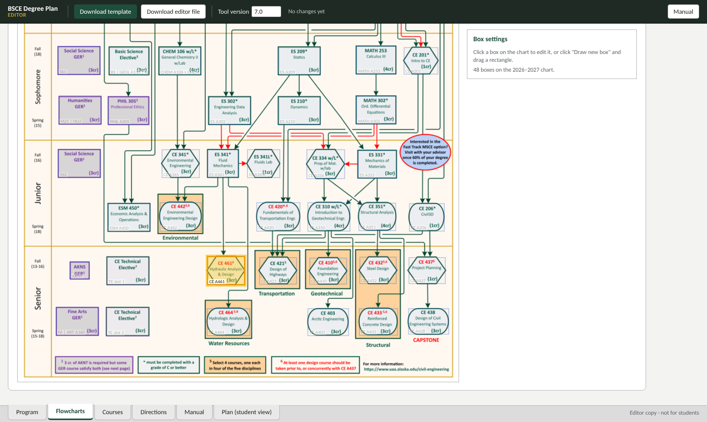
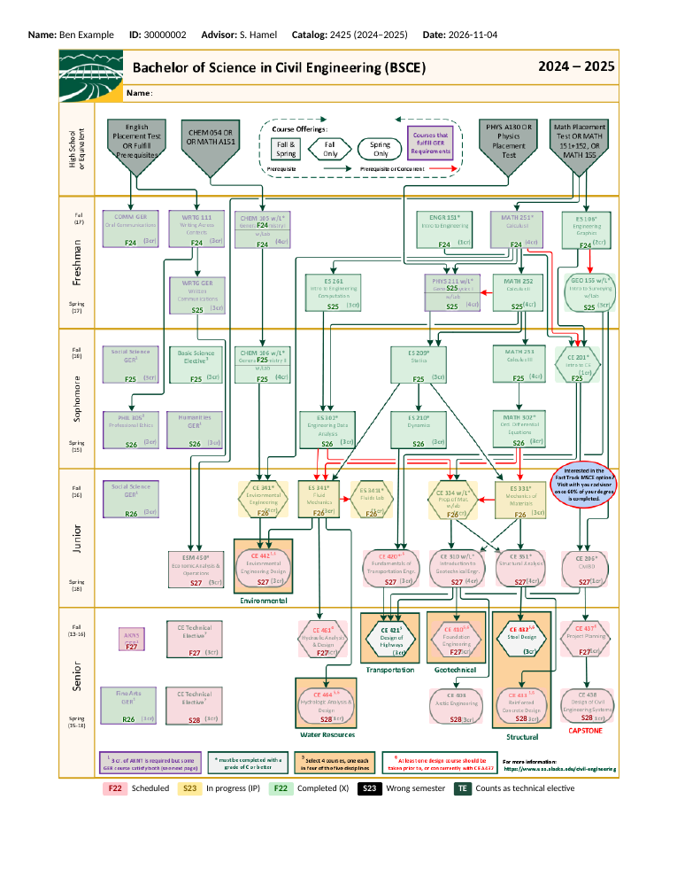
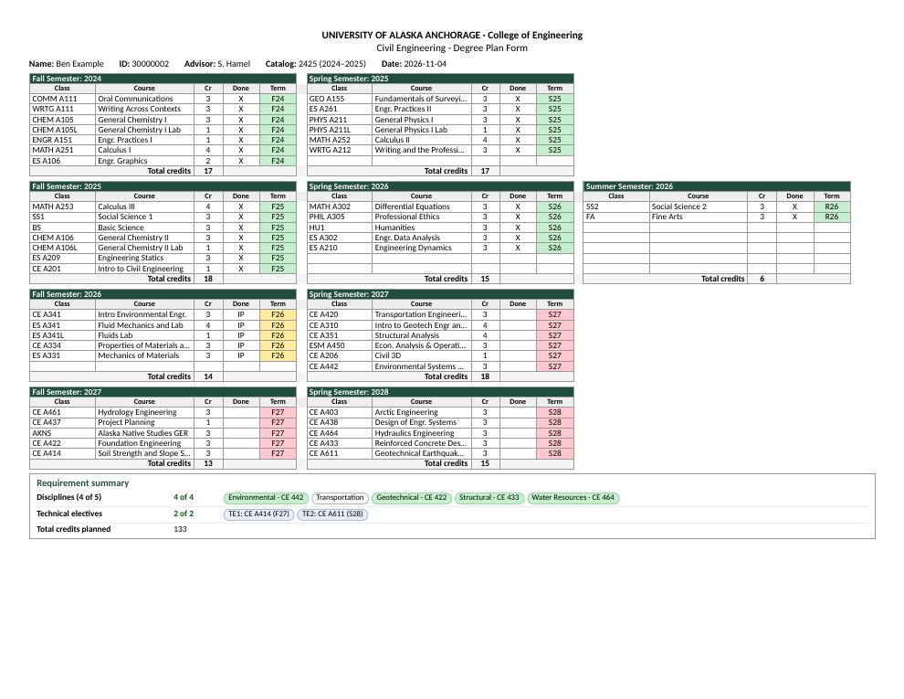

# Degree Flowchart Planner

A stand-alone, offline degree planner built around a program's own flow chart. Students type in their courses by semester, and the matching boxes on the flow chart color in: **green** for completed, **yellow** for in progress, **red** for planned, and **black** for a course placed in a semester it isn't offered.

The whole tool is a single HTML file. It opens in any browser, needs no server, no login and no install, and keeps student data on the student's own computer. Saved plans are HTML files too, so a student can email their plan to an advisor, who double-clicks it to see the plan.

The example in this repo is the **Bachelor of Science in Civil Engineering (BSCE)** at the **University of Alaska Anchorage**, with flow charts for seven catalog years (2020–21 through 2026–27). It can be adapted to any program that has a flow chart. See [docs/ADAPTING.md](docs/ADAPTING.md).



## Try it

1. Download [`dist/BSCE_DegreePlan_TEMPLATE_v7.0.html`](dist/BSCE_DegreePlan_TEMPLATE_v7.0.html) and open it in Chrome, Edge, Firefox or Safari.
2. Click **Open plan** and choose one of the sample plans in [`examples/`](examples/). They are made-up students on different catalog years.
3. Change a course, then press **Ctrl+S** (or **⌘S**) to save your own copy.

## Features

**For students and advisors**
- A spreadsheet-style semester grid: course number, name, credits, Completed (X / IP) and term code. Names and credits fill in automatically, and `CE 432`, `ce432` and `CE A432` all work.
- The program's real flow chart with a colored cover on each course box, positioned for each catalog year's layout.
- A **Colored boxes** switch, so students can read the course numbers while filling in, then switch it back on to check their work.
- Zoom (Ctrl/⌘ + scroll), drag to pan, Fit height, Fit width and Full screen. The chart and the plan scroll independently.
- Requirement rules:
  - **Pick N of M groups**, for example 4 of 5 disciplines. An extra group, or a second course in the same group, overflows into the elective pool.
  - **Elective slots** filled in term order from an approved list. Each box shows which course fills it.
  - Warnings for duplicate courses, wrong-semester courses, unapproved electives and electives beyond the available slots.
- Per-year summer terms, add and remove rows and years, and a Tab order that runs down each term.
- **Save plan** creates a new file every time (`Smith_2425_DegreePlan_2026-11-04_1430.html`), so earlier versions are always kept.
- A two-page printout: the whole flow chart on one page, the semester plan and requirement summary on the other.



**For the program owner (editor file)**
- **Program:** university, college, form title, degree name, and the names and numbers used by the rules.
- **Flowcharts:**
  - Add catalog years from a chart image, copying boxes from an earlier year.
  - Drag and resize boxes, and search for them.
  - Set which courses fill each box. `A + B` means both belong in the box; `A | B` means either one.
- **Courses:** the course list, Fall-only and Spring-only flags, the elective list, and old-to-new course number equivalents. Courses can be pasted from a spreadsheet.
- **Directions:** a small word processor for the help pop-up students see.
- **Manual:** step-by-step instructions inside the file.
- **Download template** produces the blank file you hand out. **Download editor file** saves your working copy.



| Printed chart | Printed plan |
|---|---|
|  |  |

## How it fits together

```
Editor file (program owner)
   │  Download template
   ▼
Template (blank)  ── student fills in, Save plan ──▶  Smith_..._DegreePlan_<date>.html
                                                         │  emailed to advisor
                                                         ▼
                                       advisor opens, edits, Save plan ──▶ new dated file
```

A browser can't overwrite the HTML file it has open, so every save creates a new file. That gives you version history for free.

## Repository layout

| Path | What it is |
|---|---|
| `src/app.js`, `src/app.css` | The whole application: rules engine, plan grid, chart, editor |
| `data/uaa-bsce/program.json` | The UAA BSCE example: program names, rules, courses, equivalents, catalog years and box positions |
| `data/uaa-bsce/charts/*.png` | Flow chart images, one per catalog year |
| `scripts/build.py` | Builds the two HTML files from `src/` and a program folder (standard library Python only) |
| `dist/` | Prebuilt template and editor for the example |
| `examples/` | Sample plans (fictional students) |
| `docs/` | [Adapting it to your program](docs/ADAPTING.md), [how it works](docs/HOW-IT-WORKS.md), screenshots |

## Build from source

```bash
python3 scripts/build.py data/uaa-bsce
# wrote dist/BSCE_DegreePlan_TEMPLATE_v7.0.html
# wrote dist/BSCE_DegreePlan_EDITOR_v7.0.html
```

This standard build is the one to hand to advisors. The program is fixed by `program.json` (UAA BSCE), and the editor has no Program tab. To adapt the tool to a different program, build an editor that has the Program tab and the course import / remove-all tools:

```bash
python3 scripts/build.py data/uaa-bsce --program-tab
```

An editor keeps its build type when it saves new files. There are no dependencies and no bundler. Edit `src/app.js` or `src/app.css`, rebuild, and open the file in a browser.

## Privacy

Nothing is sent over the network. The page loads no external scripts, fonts or images. A student's name and ID live only in the plan files they choose to save. While someone works in a blank template, the browser keeps a backup copy in its local storage on that computer, and it is cleared once the plan is saved to a file.

## Limitations

- Terms are Fall, Spring and Summer. Quarter systems aren't supported.
- Prerequisites, grade minimums and GPA aren't checked. The flow chart shows them, and the advisor confirms them.
- Some mail systems flag `.html` attachments. Zip the file or share it from a drive if that happens.
- Each file is about 2–3 MB because the chart images are embedded.

## Credits

Based on an Excel "live flow chart" used for advising and the Intro to Civil Engineering class in the Department of Civil Engineering at the University of Alaska Anchorage. Built by Vadim Egorov with help from Claude (Anthropic).

## License

The code (`src/`, `scripts/`) is released under the [MIT License](LICENSE).

The University of Alaska Anchorage name, flow chart images and course information in `data/uaa-bsce/` belong to the University of Alaska Anchorage and are included only as an example. Replace them with your own program's material when you adapt the tool.
