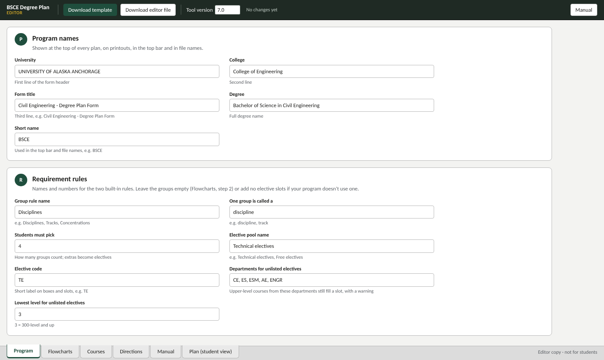

# Adapting the planner to your program

There are two ways to set the planner up for another degree. Most people should use the editor, which needs no code.

## Option A: in the editor (no code)

You need your program's flow chart as an image (PNG or JPG, ideally 1600 px wide or more) and your course list.

### 1. Open the editor

Open `dist/BSCE_DegreePlan_EDITOR_v7.0.html` in Chrome or Edge. It opens on the **Flowcharts** tab, and the tabs are at the bottom of the page.

### 2. Program tab: names and rules



- **University, College, Form title, Degree:** these appear at the top of every plan and printout.
- **Short name**, for example `BSME`. It's used in the top bar and in file names (`BSME_DegreePlan_TEMPLATE_…`).
- **Requirement rules:**
  - **Group rule name**, **One group is called a**, **Students must pick:** for a "choose N of these groups" requirement, like "4 of 5 disciplines" in the example. If your program has none, leave the groups empty in step 4.
  - **Elective pool name** and **Elective code:** for example "Free electives" / `FE`. These label the elective slots on the chart.
  - **Departments for unlisted electives**, **Lowest level:** an upper-level course from these departments that isn't on the approved list still fills an elective slot, with a "check with your advisor" warning.

### 3. Courses tab: replace the course list

1. Click **Remove all** to clear the UAA courses.
2. Click **Import courses…** and paste one course per line: `number, name, credits, offered, on elective list`.

   ```
   ME A101, Intro to Mechanical Engineering, 3, F
   ME A202, Statics, 3,
   ME A454, Robotics, 3, , yes
   ```

   *Offered* is `F` (Fall only), `S` (Spring only) or blank (either). It drives the black "wrong semester" warning. Commas or tabs both work, so you can paste straight from a spreadsheet.
3. Clear **Equivalent course numbers**. Add your own if courses have been renumbered (`ME A410 = ME A422`): the first number is the one on the chart, and older ones count for the same box.

Course numbers follow the pattern `DEPT A123`. Typing `DEPT 123` is converted automatically. Placeholder codes such as `SS1`, `HU1`, `FA` or `TE1` can be anything without a space.

### 4. Flowcharts tab: add your chart and place the boxes

1. **Step 1, Catalog year:** click **+ Add catalog year**. Enter a 4-digit code (`2627` for 2026–27), a label, and your chart image. Choose **Copy boxes from: Don't copy**.
2. Delete the example years. Select each UAA year in the dropdown and click **Delete year**.
3. **Step 2, groups:** set up your "pick N" groups, or remove all rows if you don't have one. Each row has a name and its course numbers, separated by commas.
4. **Step 3, boxes:** click **Draw new box** and drag a rectangle over each course box on your chart. In **Box settings**, type what fills it:

   | You type | Meaning |
   |---|---|
   | `MATH A251` | one course |
   | `CHEM A105 + CHEM A105L` | both belong in the box (it splits into two strips) |
   | `HU1 \| HU2` | either one |
   | `FA \| ART A160` | a placeholder code or a real course |

   For elective boxes, set **Type** to *Elective slot* and number them 1, 2, 3… in the order they should fill.
5. Use **Duplicate** for rows of similar boxes, the arrow keys to nudge (Shift for 10 px), and the search field to find a box again.

### 5. Directions and testing

- **Directions tab:** rewrite the student help text for your program, and check it with **Preview**.
- **Plan (student view) tab:** enter a realistic plan and check that every box colors in.

### 6. Save and share

- **Download editor file**, or Ctrl+S. Keep this file; it's your working copy.
- **Download template.** This is the file you give to students and advisors.

When a new catalog comes out, open your editor file, add the year (copying boxes from the previous year saves most of the work), and download both files again.

## Option B: from source

1. Copy `data/uaa-bsce/` to `data/your-program/`.
2. Replace the images in `charts/` and edit `program.json`. The format is described in [HOW-IT-WORKS.md](HOW-IT-WORKS.md#data-format). Box coordinates are in pixels of the chart image.
3. Build:

   ```bash
   python3 scripts/build.py data/your-program
   ```

A practical mix: do the box placement in the editor, where you can see it, then copy the resulting `DATA` back into `program.json` for version control. To get that data, open the editor, open the browser console and run `copy(JSON.stringify(__degreePlan.DATA))`. The chart images come out as `data:` URLs; save them as files and point `image` at them, or leave them inline.
